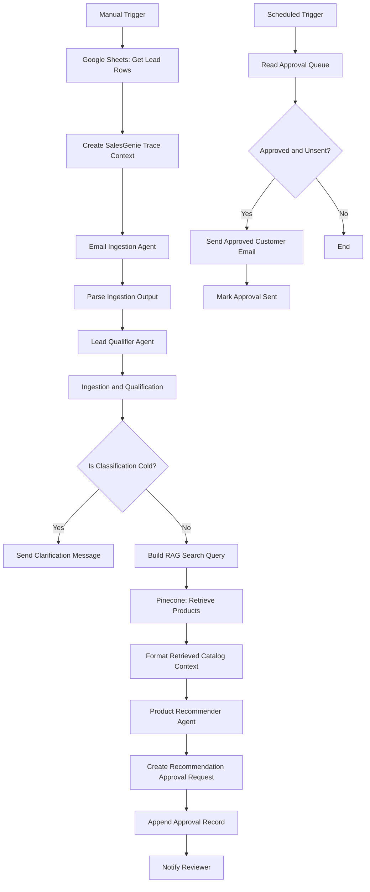
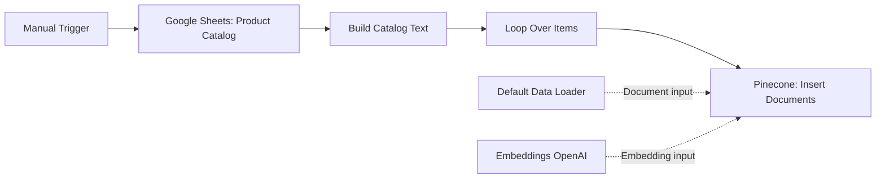

# SalesGenie — AI-Powered Sales Assistant

SalesGenie is an agentic-AI sales workflow for **Oak & Ember Interiors**, a home and office furniture retailer. It helps process inbound customer enquiries, qualify sales leads, retrieve relevant products from the approved catalog, prepare grounded recommendations, require human approval before sending recommendation emails, and generate weekly sales insights.

## Project Purpose

The project addresses manual sales-intake inefficiencies identified in the SalesGenie brief:

- Sales representatives manually read and interpret inbound enquiry emails.
- Manual entry into Excel can create mistakes, duplicates, and omissions.
- Product recommendations based on requirements and budget are time-consuming and error-prone.
- Lead qualification is inconsistent.
- CRM visibility is not real time.
- Weekly sales insights are compiled manually.

SalesGenie supports sales representatives; it does not replace sales judgment. Customer-facing recommendation emails are subject to human approval in the current implementation.

## Core Capabilities

### 1. Email ingestion

The Email Ingestion Agent extracts structured lead data from an inbound enquiry, including:

- Lead ID
- Customer name
- Customer email
- Company
- Product interest
- Budget
- Urgency
- Notes and requirements

### 2. Lead qualification

The Lead Qualifier classifies eligible sales enquiries as:

```text
Hot
Warm
Cold
```

- **Cold:** Routes to a clarification-email path(he cold-lead route currently sends to a fixed email address). No specific products are recommended.
- **Warm / Hot:** Routes to catalog retrieval and product recommendation.

### 3. Grounded product recommendations

SalesGenie uses the Oak & Ember product catalog as the source of truth for:

- Product IDs
- Product names
- Categories
- Prices
- Availability
- Documented product features and descriptions

Recommendations must not invent products, pricing, availability, delivery promises, discounts, or product features.

### 4. RAG catalog retrieval

The catalog is indexed into Pinecone. For Hot and Warm leads, SalesGenie generates a search query from the customer requirements and retrieves relevant catalog products before calling the Product Recommender.

### 5. Human-in-the-loop approval

Recommendation drafts are written to an approval queue with status:

```text
Pending
```

A reviewer chooses:

```text
Approved
```

or:

```text
Rejected
```

Only an Approved record with an empty `sent_at` value can result in a customer recommendation email.

### 6. Weekly sales insights

A scheduled reporting path is included in the same n8n workflow export. It reads lead-result data, filters the reporting period, and calculates weekly sales metrics.

- Total leads
- Hot/Warm/Cold breakdown
- Top product-interest categories
- Average budget
- Pipeline-budget indicators where available

## Architecture


Observability Branches
flowchart LR

    D[Email Ingestion Agent]
    D --> D1[Build Email Ingestion OTEL Payload]
    D1 --> D2[Langfuse: Send Ingestion Span]

    F[Lead Qualifier Agent]
    F --> F1[Build Qualifier OTEL Payload]
    F1 --> F2[Langfuse: Send Qualifier Span]

    K[Pinecone: Retrieve Products]
    K --> K1[RAG: Build Pinecone Trace]
    K1 --> K2[RAG: Send Pinecone Trace to Langfuse]

    M[Product Recommender Agent]
    M --> M1[Recommendation: Build OTEL Payload]
    M1 --> M2[Recommendation: Send Trace to Langfuse]

## RAG Catalog Indexing Flow

The catalog-indexing process is a separate path inside the same exported n8n workflow. It reads the product catalog, builds catalog text, generates embeddings, and inserts product documents into Pinecone.



The catalog indexing flow stores product documents in Pinecone. The lead-processing flow retrieves from the same Pinecone index and namespace.

```text
Catalog workflow: stores product records
Lead workflow: retrieves product records
```

Customer lead details and RAG queries must not be indexed as catalog documents.

## Technology Used in the Current Prototype

| Component | Current use |
|---|---|
| n8n | Workflow and agent orchestration |
| Google Sheets | Product catalog, lead-result data, approval queue, and reporting data |
| Pinecone | Catalog retrieval / vector store |
| OpenAI Chat Model | Agent reasoning, extraction, qualification, and recommendation generation |
| OpenAI Embeddings | Catalog indexing embeddings |
| Langfuse | Tracing and observability |
| Gmail | Internal approval notification and approved customer email delivery |

## Repository Structure

```text
.
├── README.md
├── Salesgenie_proj/
├── workflows/
│   ├── salesgenie_workflow.json
├── docs/
│   ├── salesgenie_brd_final.md
│   ├── salesgenie_prd_final.md
│   └── architecture_diagrams.svg
├── prompts/
│   ├── email_ingestion_prompt.md
│   ├── lead_qualifier_prompt.md
│   └── product_recommender_prompt.md
└── evaluation/
    └── baseline_test_results.csv
```

> The folder and file names above are a recommended repository structure. Update them to match the exported workflow and document filenames used in the repository.

## Setup Overview

### 1. Prepare source data

Prepare the product catalog in Google Sheets. Each product requires, at minimum:

```text
product_id
product_name
category
price
availability
description
```

Use consistent availability values:

```text
In Stock
Out of Stock
```

### 2. Configure workflow credentials

Configure the applicable credentials in n8n:

- Google Sheets
- Pinecone
- OpenAI Chat Model
- OpenAI Embeddings
- Gmail
- Langfuse

Do not commit API keys, credentials, OAuth tokens, or secrets to GitHub.

### 3. Index the catalog in Pinecone

Run the catalog indexing workflow before testing recommendations.

The Pinecone catalog index should contain product documents such as:

```text
Product ID: P002
Product Name: Adjustable Standing Desk Pro
Category: Desk
Price: 749
Availability: In Stock
Description: Electric height-adjustable desk with memory presets and dual motors.
```

### 4. Import and configure the lead-processing workflow

Import the SalesGenie lead-processing workflow into n8n. Confirm that:

```text
Cold  → Clarification route
Warm  → Pinecone retrieval → Product recommendation
Hot   → Pinecone retrieval → Product recommendation
```

### 5. Configure the approval queue

Create a Google Sheets tab named:

```text
salesgenie_approvals
```

Required headers:

```text
approval_id
lead_id
lead_tier
customer_name
customer_email
recommended_product_names
draft_subject
draft_body
approval_status
reviewer_name
reviewed_at
sent_at
```

### 6. Configure approved-email sender

The approved-email sender is a separate scheduled workflow. It must send an email only when:

```text
approval_status = Approved
AND
sent_at is empty
```

After successful delivery, the workflow writes a timestamp to:

```text
sent_at
```

## Product Recommendation Rules

The Product Recommender must:

- Use only products in the received catalog context.
- Use exact product IDs, names, prices, and availability from catalog data.
- Exclude out-of-stock products.
- Exclude products above the applicable budget.
- Use only features supported by the catalog description.
- Return `no_match` when no eligible product exists.
- State relevant limitations rather than claiming unsupported fit.

## Evaluation

The supplied baseline dataset contains eleven test inputs. Results are documented in 'baseline_test_results.csv`.


## Observability

SalesGenie uses Langfuse for tracing and evaluation evidence.

Recommended trace coverage includes:

```text
Email ingestion
Lead qualification
RAG retrieval
Product recommendation
```

Do not place Langfuse HTTP response data in the main business-data path. Tracing should remain a side branch so it does not replace the lead or recommendation data passed to downstream nodes.

## Human-in-the-Loop Policy

```text
Pending  → Await reviewer decision
Approved → Send once, then populate sent_at
Rejected → Do not send
```

The approval workflow is designed to prevent recommendation emails from being sent automatically without reviewer approval.

## Known Open Decisions

The following decisions remain to be confirmed:

- Final handling of product questions, spam, and support enquiries before lead qualification.
- Named owner for catalog maintenance and Pinecone re-indexing.
- Named approval reviewer and expected approval handling time.
- Data-retention, access-control, privacy, and compliance requirements.
- Final production CRM integration, if any.
- Final model/version, token limits, and cost controls.
- Formal business success targets beyond the supplied baseline test requirements.

## Deliverables

The project brief requests the following submission evidence:

- Exported workflow JSON files
- GitHub repository with README
- Workflow canvas screenshots
- SalesGenie execution screenshots
- Observability/tracing screenshots
- Architecture diagram
- Slide deck
- Five-minute demonstration video
- Baseline test results for all eleven inputs

## Privacy and PII Protection

SalesGenie processes customer information from sales enquiries. This information may include:

- Customer name
- Customer email address
- Company name
- Customer requirements
- Budget information
- Internal notes
- Draft email content

### Protection in Observability

To reduce the exposure of customer information, the custom OpenTelemetry and Langfuse payloads use only the information needed to monitor the workflow.

The traces do not include:

- The complete raw email
- The full customer email address
- Phone numbers
- Postal addresses
- Payment information
- Passwords or API keys

Instead, the trace data includes limited metadata such as:

- Lead ID
- Trace ID
- Agent name
- Customer-field presence indicators
- Raw email presence
- Raw email length
- Product interest
- Budget
- Urgency
- Product IDs
- Retrieval scores
- Number of retrieved products

The RAG and recommendation traces may include the product search query and customer requirements because they are needed to understand how the recommendation was created. Access to Langfuse is therefore limited to authorized users.

### Data Handling

Customer and lead information is stored in the configured Google Sheets, Gmail, and n8n workflow execution data.

The capstone implementation follows these practices:

- API keys and passwords are stored in n8n credentials.
- Secrets are not included in the workflow JSON.
- Raw email content is not intentionally added to the custom Langfuse trace metadata.
- Only the required customer information is used by each workflow step.
- Access to Google Sheets, n8n, Gmail, and Langfuse is restricted to authorized users.
- The workflow uses test data for demonstration purposes.